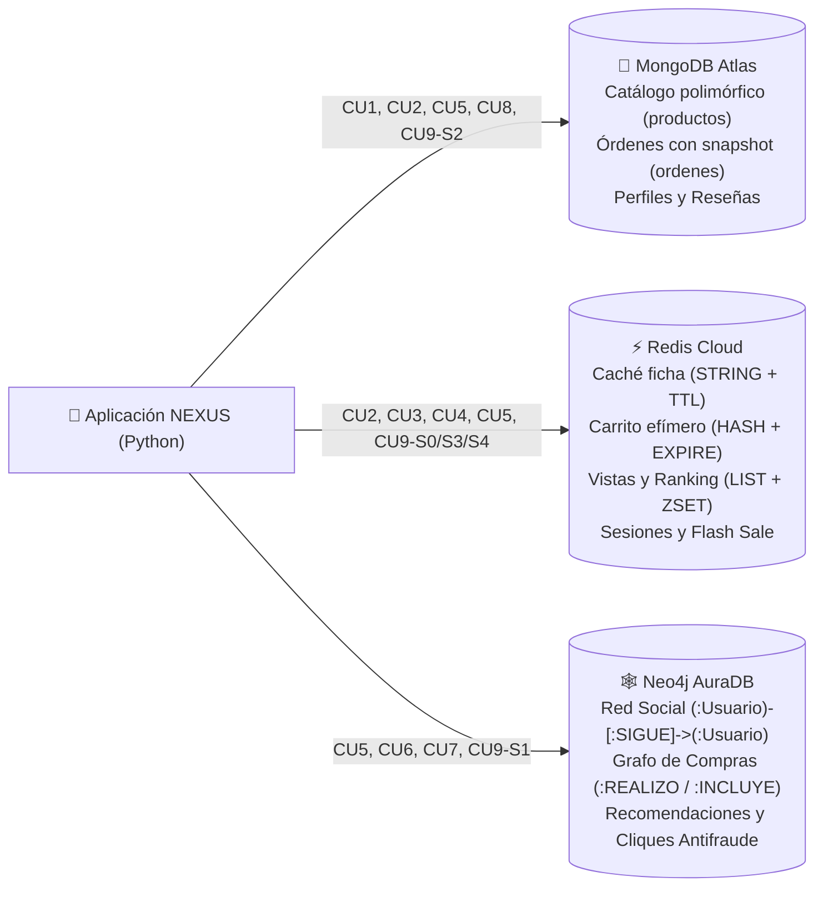

# Trabajo Práctico Integrador — NEXUS: Arquitectura de Persistencia Políglota (MongoDB + Redis + Neo4j)

---

## 1. Carátula y Datos del Estudiante

| Campo | Detalle |
| :--- | :--- |
| **Estudiante** | **Guardia, Sebastián Nicolás** |
| **Carrera** | **Tecnicatura Universitaria en Ciencia de Datos** |
| **Asignatura** | **Base de Datos II** |
| **Institución** | Universidad Nacional de Chilecito (UNdeC) — Escuela de Ingeniería |
| **Proyecto** | **NEXUS — E-Commerce de Tecnología con Persistencia Políglota** |
| **Motores Implementados** | **MongoDB Atlas** (Documental) + **Redis Cloud** (Clave-Valor en Memoria) + **Neo4j AuraDB** (Grafo de Propiedades) |
| **Estado de Verificación** | **✅ 10/10 Bloques Verificados (CU1 a CU9 + las 5 Sorpresas + Recorrido Integrador End-to-End)** |

---

## 2. 🌐 Acceso Online al Proyecto (Sin Necesidad de Descargarlo)

Podés **explorar, visualizar y ejecutar** todo el Trabajo Práctico Integrador directamente desde tu navegador web **sin descargar ningún archivo**, utilizando cualquiera de los siguientes accesos directos:

### 🚀 Opción A — Ejecutar y Probar el Código en Vivo en Google Colab
Abrí el Jupyter Notebook directamente en la nube de **Google Colab** listo para ejecutar (`Runtime ▸ Restart and run all`):

  

### 🖥️ Opción B — Visor Web Interactivo del Proyecto (Sin Descargar)
Explorá la arquitectura políglota, la matriz de decisión (CU1–CU9), el flujo transaccional de checkout, los resultados de verificación y el análisis de consistencia en un **panel interactivo HTML online**:

  

### 📖 Opción C — Lectura Rápida del Notebook Renderizado (Nbviewer / GitHub)
Visualizá el notebook completo con todas sus celdas ejecutadas, diagramas y salidas de consola directamente en el navegador:

  

---

## 3. 📂 Contenido del Directorio `Base_de_Datos_II`

* 📓 [`Integrador_bases_de_datos_poliglotas.ipynb`](./Integrador_bases_de_datos_poliglotas.ipynb): Jupyter Notebook completo, argumentado y ejecutado de punta a punta con todas las verificaciones en `✅` (`cargar_dataset()`, Matriz de Decisión, Casos de Uso `CU1` a `CU9` con las 5 sorpresas implementadas, Recorrido Integrador, Diagrama de Arquitectura y Análisis de Consistencia).
* 🌐 [`visor_interactivo.html`](./visor_interactivo.html): Panel web interactivo para consultar la arquitectura, decisiones de persistencia y resultados de pruebas desde el navegador sin descargar el proyecto.
* ⚙️ [`requirements.txt`](./requirements.txt): Dependencias oficiales de Python (`pymongo`, `redis`, `neo4j`).

---

## 4. 🏛️ Síntesis de la Arquitectura de Persistencia Políglota

| Caso de Uso | Motor(es) | Estructura / Modelo | Justificación Principal |
| :--- | :--- | :--- | :--- |
| **CU1 · Catálogo heterogéneo** | **MongoDB** | Colección `productos` (`_id`, `categoria`, `precio`, `atributos` libre, `tags`) | Esquema flexible (*schema-less*) para múltiples categorías con atributos dispares y filtros compuestos indexados. |
| **CU2 · Detalle rápido** | **Redis + MongoDB** | Patrón *Cache-Aside*: `STRING` `cache:producto:{id}` (`TTL=300s`) + invalidación `DEL` | Latencia sub-milisegundo en RAM para productos muy consultados, sin precios viejos al actualizar y con *fallback* a MongoDB si cae Redis. |
| **CU3 · Navegación** | **Redis** | `LIST` `vistas:usuario:{uid}` (`LREM+LPUSH+LTRIM`) + `ZSET` `vistas:ranking` (`ZINCRBY`) | Historial reciente sin duplicados en `O(1)` y ranking global de más vistos ordenado en tiempo real en `O(log N)`. |
| **CU4 · Carrito que vence** | **Redis** | `HASH` `carrito:{uid}` (`HINCRBY` / `HDEL`) + `EXPIRE {ttl_segundos}` | Mutación atómica de cantidades por ítem y expiración nativa automática tras 30 minutos de inactividad. |
| **CU5 · Checkout** | **Redis + MongoDB + Neo4j** | Lectura/borrado de carrito (Redis) + descuento de stock e inserción en `ordenes` con *snapshot* (Mongo) + proyección al grafo (Neo4j) | Transacción políglota con compensación de inventario, inmutabilidad histórica de precios y actualización inmediata de recomendaciones. |
| **CU6 · Red social** | **Neo4j** | `(:Usuario {id})-[:SIGUE]->(:Usuario {id})` | Recorrido de 2 saltos (*amigos de amigos*) ordenado por intermediarios en común mediante *index-free adjacency*. |
| **CU7 · Recomendaciones** | **Neo4j** | `(:Usuario)-[:SIGUE]->(:Usuario)-[:REALIZO]->(:Orden)-[:INCLUYE]->(:Producto)` | Co-compras por orden compartida (`count(DISTINCT o)`) y compras de la red excluyendo productos ya comprados por el usuario. |
| **CU8 · Historial de compras** | **MongoDB** | Colección `ordenes` con índice compuesto `(usuario_id, fecha DESC)` | Lectura de un solo documento autocontenido por orden (con sus ítems y precios históricos) sin necesidad de joins ni traversals. |
| **CU9 · Requisitos Sorpresa (S0–S4)** | **Neo4j / Redis / MongoDB** | **S1:** Cliques maximales en Neo4j · **S0/S3/S4:** `DECR`, `SETEX+ZSET` y `ZSET` semanal en Redis · **S2:** `resenas` en MongoDB | **Las 5 sorpresas están implementadas y verificadas** para que el notebook pase al 100% con cualquier `NUMERO_EQUIPO`. |

---

## 5. 🔑 Configuración de Secretos en Google Colab (`Colab Secrets`)

Por regla de seguridad del Trabajo Práctico, **ninguna credencial está hardcodeada en el código**. Para re-ejecutar el notebook en Google Colab contra las instancias cloud, cargá en el panel **🔑 Secrets** de Colab las 7 variables con acceso habilitado (*Notebook access*):

| Nombre del Secreto | Valor / Formato |
| :--- | :--- |
| `MONGO_URI` | `mongodb+srv://basededatos:Base.1234@<tu-cluster>.mongodb.net/` *(con `0.0.0.0/0` activo en Network Access)* |
| `REDIS_HOST` | `neogentle-squirrel-wax-72538.db.redis.io` |
| `REDIS_PORT` | `15341` |
| `REDIS_PASSWORD` | Password del usuario `default` en Redis Cloud (`database-MWMJ4SDD`) |
| `NEO4J_URI` | `neo4j+s://9fee43d5.databases.neo4j.io` |
| `NEO4J_USER` | `9fee43d5` |
| `NEO4J_PASSWORD` | Password del archivo `Neo4j-9fee43d5-Created-2026-11-18.txt` de AuraDB (`Instance01`) |
