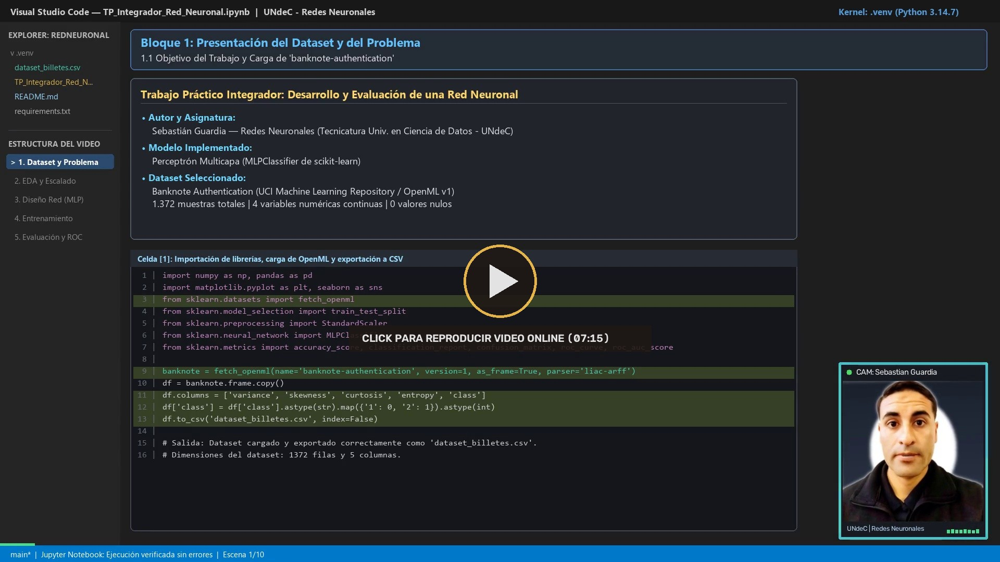

# Trabajo Práctico Integrador — Redes Neuronales (UNdeC)

[-2ea44f?style=flat-square)](https://htmlpreview.github.io/?https://github.com/sguardia26/UNDEC/blob/main/Redes_Neuronales/player.html)

Desarrollo y evaluación de una red neuronal (**Perceptrón Multicapa — `MLPClassifier`**) en Python con `scikit-learn` para la clasificación binaria de billetes auténticos vs. falsificados (*Banknote Authentication*).

## 🎥 Video Explicativo

<video src="https://raw.githubusercontent.com/sguardia26/UNDEC/main/Redes_Neuronales/TP_Integrador_Red_Neuronal_Video.mp4" controls width="100%"></video>

## Contenido de la carpeta
* [`TP_Integrador_Red_Neuronal_Video.mp4`](./TP_Integrador_Red_Neuronal_Video.mp4): Video explicativo completo en Full HD (`07:15 min`) — [▶️ **Ver Online sin descargar**](https://htmlpreview.github.io/?https://github.com/sguardia26/UNDEC/blob/main/Redes_Neuronales/player.html).
* [`TP_Integrador_Red_Neuronal.ipynb`](./TP_Integrador_Red_Neuronal.ipynb): Notebook completo con análisis exploratorio (EDA), preprocesamiento sin *data leakage*, entrenamiento de la red neuronal y evaluación de métricas.
* [`dataset_billetes.csv`](./dataset_billetes.csv): Copia limpia del dataset (*1.372 muestras, 4 variables Wavelet + etiqueta binaria `class`*).
* [`requirements.txt`](./requirements.txt): Dependencias de Python necesarias para ejecutar el proyecto.
